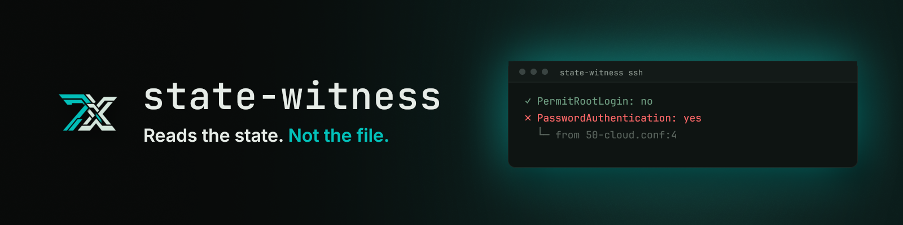

<div align="center">



[](CHANGELOG.md)
[](#license)
[](https://www.rust-lang.org)
[](#contributing)


</div>

# state-witness

An **effective-state** security auditor for Linux — with extra awareness of
immutable/atomic hosts (Fedora Atomic, Bazzite, `bootc` / RHEL Image Mode).

It reports what the running system **actually enforces** — `sshd -T`, `sysctl -n`,
the live packet filter, real `/etc/passwd` and `/etc/shadow` — and cites where each
value came from. It does not read a config file and assume it is in effect.

**Status:** v0.2.0 · 5 commands · 25 checks · text and JSON output.

---

## Install

```bash
# from source (works today)
git clone https://github.com/7sh1d0w7x/state-witness
cd state-witness
cargo build --release

# crates.io — planned, not published yet
# cargo install state-witness
```

The binary is a single executable with no runtime engine.

### Static build (musl)

A statically linked build runs on any Linux distribution, including minimal
containers. The musl target has to be installed first:

```bash
rustup target add x86_64-unknown-linux-musl
cargo build --release --target x86_64-unknown-linux-musl

podman run --rm \
  -v "$PWD/target/x86_64-unknown-linux-musl/release/state-witness:/sw:ro,Z" \
  alpine:latest sh -c '/sw sysctl; /sw users'
```

> **SELinux note (Fedora/RHEL):** mount with `:Z` (or copy the binary into the
> container). Without it the container cannot execute the file.

---

## Usage

```bash
state-witness ssh          # effective SSH daemon configuration
state-witness atomic       # ostree/bootc deployment + /etc drift
state-witness sysctl       # effective kernel parameters
state-witness firewall     # active packet filter
state-witness users        # uid-0 accounts, NOPASSWD, empty passwords

state-witness <command> --json   # machine-readable output
state-witness <command> --quiet  # no attribution footer (text output only)
```

Real output from a Bazzite host:

```console
$ state-witness sysctl
✗ IP forwarding: net.ipv4.ip_forward = 1 (expected 0)
  └─ from (effective, sysctl -n)
✓ ASLR (randomize_va_space): kernel.randomize_va_space = 2
  └─ from (effective, sysctl -n)
✗ kptr_restrict (hide kernel pointers): kernel.kptr_restrict = 0 (expected 1)
  └─ from (effective, sysctl -n)

$ state-witness ssh
– SSH effective config: sshd -T failed (try as root)
  └─ from (effective, sshd -T)

$ state-witness atomic
✓ Deployment: ostree-image-signed:docker://ghcr.io/ublue-os/bazzite:stable
  └─ from (effective, rpm-ostree status)
✓ Deployment signature: valid
  └─ from (effective, rpm-ostree status)
```

`sshd -T` reads host keys, so the `ssh` check usually needs root. Without it the
check returns `Skip` **with a reason** — never a failure.

### Exit codes

The same policy applies to text and JSON output:

| Code | Meaning |
|---|---|
| `0` | The audit ran; every finding is `pass`, `warn` or `skip` |
| `1` | The audit ran; at least one finding is `fail` |
| `2` | The audit could not produce a result (usage error, unreadable input, serialization failure) |

Exit codes `1` and `2` mean different things on purpose: "the system has findings"
is not "the tool broke".

### Output contract

- **stdout** carries the report only — text, or a single JSON array.
- **stderr** carries diagnostics.
- JSON is a plain array of findings:

```json
[
  {
    "id": "FW-003",
    "title": "firewalld",
    "status": "pass",
    "value": "running",
    "provenance": {
      "path": "(effective, firewall-cmd --state)",
      "line": null
    }
  }
]
```

`status` is one of `pass`, `warn`, `fail`, `skip`.

> **Not versioned yet.** The JSON shape is stable in practice but there is no
> schema version field — that is tracked in the roadmap. Pin the tool version if
> you consume the output in CI.

---

## What it checks (v0.2.0)

25 checks across 5 commands. Every finding carries `provenance`: the command or
file that produced the value.

| Command | Checks | Source |
|---|---|---|
| `ssh` | `PermitRootLogin`, `PasswordAuthentication`, `PermitEmptyPasswords`, `MaxAuthTries`, `X11Forwarding`, `AllowUsers`/`AllowGroups`, `ListenAddress`, weak crypto | `sshd -T` |
| `sysctl` | IP forwarding, ASLR, reverse-path filtering, `dmesg_restrict`, `kptr_restrict`, Yama `ptrace_scope`, TCP syncookies | `sysctl -n` |
| `firewall` | nftables ruleset, ufw state, firewalld state | `nft list ruleset`, `ufw status`, `firewall-cmd --state` |
| `users` | extra uid-0 accounts, `NOPASSWD` sudoers entries, empty password fields | `/etc/passwd`, `/etc/sudoers`, `/etc/shadow` |
| `atomic` | deployment image, signature status, pin state, `/etc` drift | `rpm-ostree status`, `bootc status --json`, `ostree admin config-diff` |

📄 **[`docs/CHECKS.md`](docs/CHECKS.md)** — per-check detail and implementation
status · **[`docs/DESIGN.md`](docs/DESIGN.md)** — architecture.

📘 **[`docs/runbooks/`](docs/runbooks/)** — procedures that use the tool for a real
change, with the evidence from the run that produced them.

📗 **[`docs/case-studies/`](docs/case-studies/)** — the same sessions written up for
a reader who was not there: what the count found, what was changed, what the proof
looked like.

### What "provenance" means here

Each finding names **the command or file its value came from** — for example
`(effective, sysctl -n)` or `/etc/passwd`.

It does **not** yet emit a line number inside the file that set the value. That
requires resolving include/drop-in chains and is not implemented in v0.2.0; the
`line` field exists in the JSON and is currently always `null`.

---

## Limits

Stated plainly, so you can decide whether the tool fits:

- **Focused, not exhaustive.** 25 checks. It is not a compliance framework and
  not a SCAP implementation.
- **No remediation.** `state-witness` never modifies the host. It reports; changes
  are yours to apply.
- **No compliance mapping.** NIST/CRA/BSI control mapping is not implemented.
- **No SARIF yet.** Text and JSON only.
- **Heuristic rules are simple.** Thresholds such as "ASLR should be 2" are
  defaults, not a policy engine. Expect to interpret results, not just consume
  a grade.
- **`Skip` is not `pass`.** If a check cannot run (missing tool, no permission),
  it says so. A report full of `skip` findings means "not checked", not "clean".

Other tools exist in this space with broader rule sets and formal compliance
content. `state-witness` does not claim parity with them; it targets a narrower
question — *what does this host enforce right now, and where did that value come
from* — with awareness of immutable hosts.

---

## Design in one screen

```
Finding = id, title, status (pass|warn|fail|skip), value, provenance
```

- **Effective over declared.** Ask the daemon or the kernel, not the file.
- **Provenance always.** Every finding says where the value came from — including
  `skip` findings ("unknown because X was unavailable" is a fact worth citing).
- **Skip, never false-fail.** A check that cannot run returns `Skip(reason)`.
- **Read-only.** Checks never modify the host.
- **Structured output.** Text for humans, JSON for CI, same exit-code policy.

---

## AI usage & authorship

AI assistance is used in this project. The repository documents verification steps,
known limitations, and what remains unverified.

- **Verification:** `cargo fmt --check`, `cargo clippy --all-targets -- -D warnings`
  and `cargo test` (see `CONTRIBUTING.md`), plus the transcripts shipped next to each
  runbook in [`docs/runbooks/`](docs/runbooks/).
- **Known limitations:** [`docs/CHECKS.md`](docs/CHECKS.md) separates implemented
  checks from planned ones, and the roadmap below is explicitly "planned, not
  implemented".
- **Unverified:** no independent audit, and no third party has reproduced these
  results.

---

## Roadmap

Planned, not implemented — listed so the README cannot drift ahead of the code:

- more checks (listening sockets, SUID/SGID, file capabilities, SELinux/AppArmor
  enforcement, systemd hardening, audit subsystem)
- a versioned JSON schema
- SARIF 2.1.0 output
- remediation planning (`--plan` / `--apply`) with rollback
- compliance control mapping

## License

MIT OR Apache-2.0 (Rust convention).

## Contributing

Issues and pull requests are welcome. See `CONTRIBUTING.md`.

---

*Design brief: 29 September 2026.*
